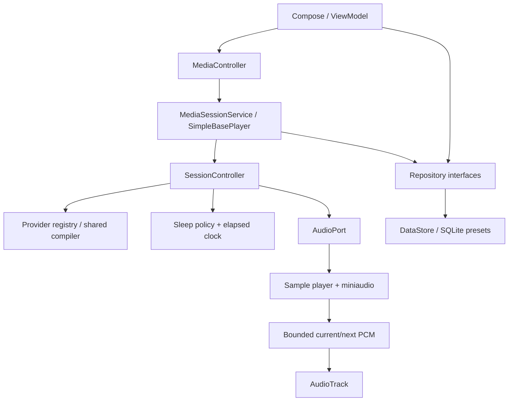

# Architecture and behavioral contracts

Status: implemented Stage 0–4 contracts, reviewed 2026-10-11. All six modules exist.
G1/G2 have historical acceptance; G3/G4 retain unsupported acceptance rows.
See STATUS and the dated project review for exact test outcomes.

## Modules and ownership

| Module | Introduced | Dependencies / ownership |
| --- | --- | --- |
| app | Existing | Activity, Compose/ViewModels, manual composition root; consumes training/audio/media/data |
| core:music | Existing | Pure Kotlin pitches, intervals and later theory; no Android |
| core:training | Existing | Pure Kotlin generators, recipes, timelines, session state/timer policy and repository ports; depends on music |
| core:audio | WP2.2 (renderer implemented) | Android/JNI render/output adapter; depends on training/music; no Compose/Media3/data |
| core:media | WP3.2 | MediaSessionService, SimpleBasePlayer, focus/routes/wake ownership; depends on audio/training |
| core:data | WP4.2 | DataStore/SQLite/serialization implementations; depends on training/music; no media/audio |
| benchmark | WP8.2 if useful | Android performance journeys; never a runtime dependency |

Retain screens in app until a real boundary justifies feature modules. Do not add
core:model or core:ui merely to match the original draft. Contracts consumed by the
domain live in core:training; Android implements them without creating a dependency
back to Android from a JVM module.

The service owns the live session, player and audio lifecycle. UI disposal removes a
controller connection only. Native access has one owner worker; output writes read
completed PCM on a cancellable output worker. Media3 methods and notifications stay
on the player application looper. Coroutines use owned scopes and injected dispatchers.

## Public data contracts

- MidiNote/PitchClass/SimpleInterval model sounding pitches separately from spelling.
- Definitions/configurations and concrete exercises are immutable; copy input lists.
- GeneratorIdentity includes ID/version, RNG algorithm, seed and normalized config.
- Exercise identity includes sequence and cycle position, required voice IDs and notes.
- Recipe describes pedagogical order; presentation is supplied by the exercise.
- Timeline uses relative finite Duration offsets and semantic note/voice/marker payloads.
- VoiceDurationCatalog decouples the compiler from WAV files; AssetCatalog maps IDs to
  validated resources, exact frame counts and immutable pack hashes.
- AudioPort accepts a compiled exercise, reports consumed position/failures and
  supports prepare/play/pause/restart/stop/release through a serialized adapter.
- SessionSnapshot is the source of truth for commands, answer visibility and progress.
- Elapsed clock controls deadlines; an audit wall-clock timestamp is only for history.
- Repository ports expose domain configuration and records; SQLite rows, Preferences
  storage types, Context, native handles and Media3 classes never enter core:training.

Some names describe contracts rather than identically named classes. Keep adapters narrow; do not
duplicate an independent player/state machine in each feature.

### Exercise pipeline and providers (v0.2.x)

One provider-independent pipeline supplies every training kind:

- `TrainingKind` is a persisted stable string ID; `ProviderConfig` is a sealed hierarchy whose
  subtype fixes the kind. `ModeSetup` = provider config + recipe + optional seed + stop policy.
  `StartRequest` = `ModeSetup` + gains + answer visibility.
- `ExerciseProvider` exposes defaults, required semantic vocabulary, validation (with the injected
  voice-duration catalogue) and generator creation; `ProviderRegistry` registers only implemented
  providers, so known-but-unimplemented kinds cannot construct a Start.
- `ConcreteExercise` carries kind, provenance (including the lossless legacy interval identity),
  answer category, sequence index, real cycle metadata only, immutable CONTEXT/TARGET note groups
  and an `AnswerDescriptor` (ordered semantic voice tokens plus structured display data). A group's
  position is its scheduling slot; notes inside a group sound together; an empty group is a rest
  slot that still occupies its window.
- `ExerciseCompiler` is the only scheduler: recipe timing is authoritative, sequential groups use
  the note-length + gap stride, the context gap separates CONTEXT from TARGET, and composed answer
  tokens are separated by exactly 80 ms with one reveal marker. `CompiledExercise` adds the
  answer-start, mandatory-unit-end, optional-replay and trailing boundaries for switching.
- `ConfiguredExerciseSource` owns the provider stream: a fresh Start replays the seed; a live
  configuration edit rebuilds on the same stream so already-heard items are not replayed; the
  source keeps no timeline cache. Retained controller items own their compiled exercise and gains.
- The temporary `LastSetup` → `ProviderConfig.Intervals` conversion is the only legacy adapter and
  is replaced by per-kind saved setups in M2.

## Timing and PCM decisions

Use sample boundaries to schedule sound. Convert absolute domain offsets with
integer half-up rounding at the chosen sample rate; never use a chain of delay calls
as a musical clock. Simultaneous notes share one frame. Note-end processing precedes
a new note at the same frame. Voice markers follow consumed position.

Render one exercise in bounded blocks and cache only current/next, each limited to
60 s. This intentionally refines the earlier streaming-only description: caching a
bounded item permits position-preserving resume without reconstructing synth envelopes.
At 48 kHz stereo float32 the two items need 46,080,000 bytes; cap combined PCM at 48 MiB.
Keep scratch/voice allocations separately bounded and measure total native/Java PSS.

The in-project EARP1 sample player renders music; miniaudio supplies WAV decode, conversion and
test oscillator. AudioTrack is the sole device output. No independent voice player or MIDI realtime
scheduler. Disable reverb/chorus initially; terminate audible windows with a short
envelope so specified gaps contain silence.

Maintain three positions: rendered, submitted and consumed. The consumed estimate
comes from AudioTrack playback timestamps/head; it must handle wrap, route recreation,
flush and paused output. Hardware/acoustic latency is not identical to logical time.
Do not promise identical PCM bytes across CPU architectures.

Pause retains the consumed frame, cancels writes and flushes. Resume continues cached
PCM with a short onset ramp. Previous/Repeat reuse the concrete definition. A new
render/generator result must carry a token and be discarded if its session was stopped.
Live edits preserve the current item and backward history, discard every queued future item,
and draw a replacement under the edited setup. Items capture their recipe, gains and timeline.
PlaybackIdentity(session generation, monotonically increasing ordinal) is distinct from generator
sequence/cycle metadata and travels through preparation, PCM lookup and playback. Only reachable
controller items own timelines (20 backward items, current and a bounded forward/follower path);
the generator source has no timeline cache. PCM holds at most two entries and 48 MiB.

The production controller advances after consumption, preserves silent paused domain
navigation and bounds backward history to 20. Generator indices remain reproducibility
metadata, never audio/cache identity. Session failure invalidates pending work, clears retained
items, attempts every cleanup action and publishes the error. Transport serializes command
requests and completes failed futures; the UI reconnects and surfaces asynchronous failures.

### Mode switching (v0.2.x)

A mode request is a `SwitchMode` command carrying the service-resolved `StartRequest` and the
saved revision it acknowledged. The controller keeps the audible unit and only commits at a
safe boundary: the playback worker plays one unit at a time (the mandatory learning unit, each
optional replay, the trailing tail) and the output adapter asks a synchronous callback before
submitting past a boundary, so future old-mode audio is never queued. Every unit boundary in a
compiled timeline falls inside scheduled silence, so authorising between units cannot cut a
sounding note. Transitions: stopped acknowledges the selection only; preparing with no frames
submitted activates immediately; playing or paused stores the destination and commits after the
unit in progress; a fully consumed item or an unstarted optional/tail unit activates at once.
A destination equal to the audible request cancels a pending departure. The commit increments
the activation ordinal, uses the destination's fixed seed or the frozen `mode-seed-v1`
derivation, clears the pending state and keeps item ordinals monotonic; an expired timer or a
finish-current drain wins over the commit. Previous/Next/Repeat are refused while a switch is
pending, and Stop, failure or timer expiry clears it. Snapshots expose the audible and pending
kind plus their acknowledged revisions, so Play can describe what is heard separately from the
destination still waiting for its boundary.

## Sleep and interruptions

Duration timers use elapsed realtime and continue during pauses and preparation.
Immediate expiry flushes output; finish-current drains at most the current 60-second
exercise. Expiry while paused/preparing completes silently. Check deadlines before
every potential sound even when a paused callback was deferred by Android.

Foreground-service status alone does not keep CPU execution running. A scoped partial
wake lock belongs to active playback including silent gaps, and is released on pause,
stop, error and destruction. Paused process death restores stopped configuration.
No persisted elapsed deadline, boot autostart, exact alarm or WorkManager timer.

The service evaluates elapsed deadlines through the serialized controller every 250 ms
and immediately before sound. Its bounded wake-lock lease renews during active snapshots.
Explicit sleep-timer commands replace/cancel deadlines; fade and duck multiply independently.

Focus is acknowledged before output opens. Denial remains silent. Focus loss or a noisy/
disconnected route stops playback; route return never starts it. Ducking lowers gain while
playing and focus return restores only the duck factor. UI uses Start/Stop; domain pause/resume
remains for internal controller coverage. Task removal stops playback and releases resources.
Media3 supplies service/control integration; custom AudioTrack output owns scheduling.
See [Media3 service model](https://developer.android.com/media/media3/session/background-playback).

## Answer visibility and errors

Recognition answers appear only when the answer frame is consumed. Apply this rule
to app, mini-player, notification, Bluetooth metadata and accessibility text.
Hide-answer mode removes answers before snapshot publication, including an answer already
shown when the preference changes. App/accessibility/notification/Bluetooth metadata receive
no answer; bundled speech remains. Debug inspection is separate
and never advertised as normal media metadata.

Before save/Start validate complete recipes against the 60-second cap using shared bundled
voice-duration metadata for every selected answer/presentation. Empty roots mean all roots.
Before sound validate required semantic assets and instrument-pack sizes/hashes; same-size corruption
must fail staging.
Missing assets fail with IDs and a retryable diagnostic, not silent omission or a
different exercise. Runtime failures invalidate pending work, silence and release audio,
and enter observable Error. User configuration errors stay at setup with field feedback.

## Persistence and platform boundaries

Preferences DataStore holds settings; a plain SQLite database on the platform's
`android.database.sqlite` holds presets and later history (Room is infeasible on this
toolchain in the recorded probe; see STATUS). One application-scoped instance per
store/database. Manual application/service/ViewModel composition is implemented; Hilt is
deferred to a separate compatibility decision. Domain constructors remain ordinary Kotlin.

Settings schema 2 stores global preferences plus the selected stable kind and each mode's
saved setup with a monotonic revision. Mode writes go through revision-checked atomic
operations (`updateMode`/`saveAndSelect`) that refuse to overwrite newer edits; `update` is
for global preferences only. The intervals payload keeps its historical field set so schema 1
migrates exactly; future kind/config versions are diagnosed and protected from automatic
writes. A derived `lastSetup`/`lastMode` view is the temporary interval-editor adapter.

The preset store is schema 9: one generic, kind-scoped payload table with a stable kind id,
an optional slot number (1..5 per kind, forty slots in total), a validated payload and its
own version, the empty/built-in flags and the original timestamps. The five historical
interval slot ids are preserved; later kinds use deterministic `mode:<kind>:slot:<n>` ids.
Migration 8→9 is a driver-level Kotlin transformation shared by Android and the host tests:
it reads every version-8 row first, converts it to a schema-2 interval payload, verifies the
converted rows by decoding them back, and only then replaces the old tables inside the same
transaction. A version-8 row that a newer build wrote is never guessed at or overwritten.

Save versioned domain DTOs with stable string IDs. JSON preset import is bounded and
validated before its single SQLite transaction. Active playback state, native handles,
paths, elapsed deadlines and caches are not presets. Process restart restores stopped.

Screenshot verification is manifest-driven: `app/src/test/screenshots/manifest.json` names
every case, its baseline hash and any declared pending difference. `scripts/check-ui.sh` stays
the strict owner gate (any difference fails); `scripts/screenshot-report.py` compares candidates
strictly for approved cases, bounds a declared change to its region and reports
PENDING_VISUAL_APPROVAL instead of approving it. Only an explicit owner decision updates a
baseline.

No INTERNET permission in any installed variant. App assets remain local; OS document
picker import/export UI is retired; existing bounded data APIs and fixtures remain compatible.
The current presets UI exposes the intervals starters and its five editable slots; the other
thirty-five kind-scoped slots exist empty for later milestones.
Cloud backup stays disabled; verify API 31+ extraction rules/device-transfer policy
in both production APKs. Private caches use no-backup storage.

## Changes requiring a contract update

New generator sequence behavior, schema changes, resumption semantics, active-session
editing, asset ID changes, new instruments/voices, timing limits, or output replacement
require updated fixtures and affected documents. Record substantive architectural
tradeoffs in an ADR. Do not broaden a work package silently.

Studio MCP is development infrastructure only. Its semantic model/inspections can assist
contract review after Gradle import; canonical scripts, physical evidence and human review
remain the acceptance sources. See [ANDROID_STUDIO_MCP](../development/ANDROID_STUDIO_MCP.md).
